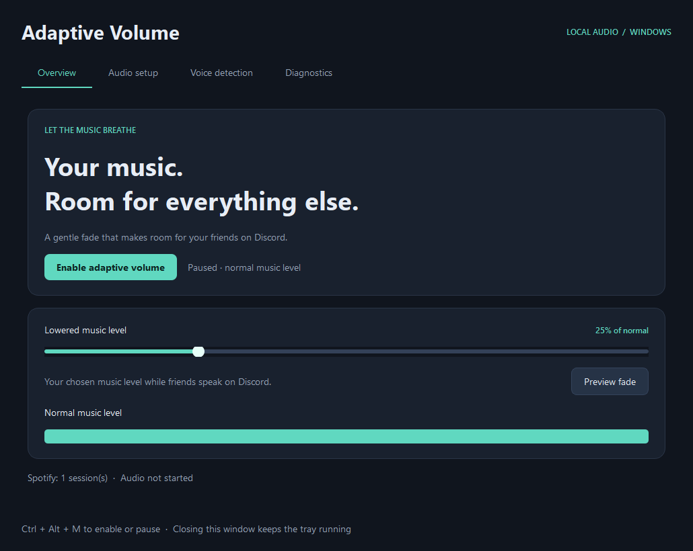

# Adaptive Volume

Adaptive Volume automatically lowers Spotify when someone speaks on Discord,
then smoothly restores the music when the conversation pauses.

**[Download the latest release](https://github.com/Morticuss/AdaptiveVolume/releases/latest)**

## Install

You need **Windows 11**, plus the **Spotify and Discord
desktop apps**. Python and extra audio drivers are not needed for the standard setup.

1. Download the **Windows x64 ZIP** from the release page.
2. Right-click it and choose **Extract All**. Put the extracted folder somewhere you can keep it, such as Documents.
3. Open **AdaptiveVolume.exe** inside that folder. Keep the `_internal` folder beside it; this contains files the app needs to run.
4. Leave Discord's output on your usual headphones or speakers. Adaptive Volume starts listening automatically in **Unbuffered** mode.

Want it to run automatically? In **Audio setup**, turn on **Start with Windows**.
The app will start in the notification area beside the Windows clock when you sign in.

## Use it

Start playing music in Spotify and join a Discord voice channel as usual.

| Control | What it does |
| --- | --- |
| **Lowered music level** | Sets Spotify's volume while someone speaks, relative to your normal volume. The default is 25%, or one quarter as high. |
| **Preview fade** | Demonstrates the volume change without needing someone to speak. |
| **Pause** | Stops automatic volume changes. **Ctrl + Alt + M** also toggles this. |

The music fades down over **25 milliseconds**. After speech ends, it waits
**1.1 seconds**, then returns to normal over **250 milliseconds** (a quarter of
a second). If someone starts speaking again, the music lowers again smoothly.
Spotify keeps playing throughout. Discord, your microphone and other apps keep
their own volume settings.

Closing the window leaves the app running. Right-click its icon beside the
Windows clock for the volume slider and quick controls, or double-click to reopen
settings. Use **Quit** from that menu to stop the app completely.

## Adjust voice detection

If background noise makes the music lower, open **Voice detection** and move
**Minimum voice level** to the right. Quieter sounds will then be ignored when
deciding whether to lower Spotify.

Watch the live audio meter while nobody speaks, then while your quietest friend
speaks. Set the minimum above the background noise but below that friend's voice.
If quiet voices stop triggering the app, move the slider left.

The numbers use **dBFS**, a measure of digital audio level: **−30 dBFS requires
louder audio than −40 dBFS**. The default is −40 dBFS. Your changes take effect
immediately and are saved.

## Optional buffered mode

In the default **Unbuffered** mode, Discord plays directly to your headphones.
Music lowering begins once speech is detected, and Discord still works if you
close the app.

The optional **Buffered** mode sends Discord through VB-CABLE and the app before
it reaches your headphones. This adds a short delay so music can begin fading
earlier. It needs an extra driver and **the app must stay running to hear Discord**.
See the [buffered setup guide](docs/BUFFERED_SETUP.md) for instructions and timing limits.

## Troubleshooting

| Problem | What to check |
| --- | --- |
| Music lowers for background noise | Raise the minimum voice level and try **Noise resistant** sensitivity in Audio setup. |
| Quiet friends do not trigger it | Lower the minimum voice level or select a more sensitive detector. |
| Nothing happens | Check that Spotify and Discord desktop are open and the app shows **Listening locally**. For the standard setup, choose **Unbuffered** in Audio setup and keep Discord's output on your headphones. |
| Discord is silent through VB-CABLE | Check the buffered setup guide, or return Discord directly to your headphones and use Unbuffered mode. |
| The app does not start with Windows | Enable **Start with Windows** again after moving the app, and check Windows Settings → Apps → Startup. |

Loud background sounds and Discord notifications can still be mistaken for speech.
See [testing and limitations](docs/TESTING.md) for what has been verified.

Buffered mode automatically reopens the bridge if the cable has audio but capture
or playback keeps returning silence. Allow several seconds for recovery. Startup,
routing and bridge health diagnostics are saved in `data/runtime.log` beside the
app, with two rotating backups. These logs contain device names and measurements,
and do not record conversations.

## Privacy and removal

Audio is analysed on your PC. Conversations are not recorded or uploaded, and
the app sends no usage telemetry. Settings are saved in the `data` folder beside
the executable. The optional Diagnostics test also saves its generated test audio
and results there.

To remove the app, turn off **Start with Windows**, quit it from the tray, then delete its folder. If you used buffered mode, restore Discord's output to your headphones first and uninstall VB-CABLE separately if desired.

## Development

See [BUILDING.md](docs/BUILDING.md) to run the source, build the app or contribute.

Licensed under [MIT](LICENSE). Bundled dependencies retain their own licenses; see [THIRD_PARTY_NOTICES.md](THIRD_PARTY_NOTICES.md).

---

Made with GPT-6.1 Sol.
